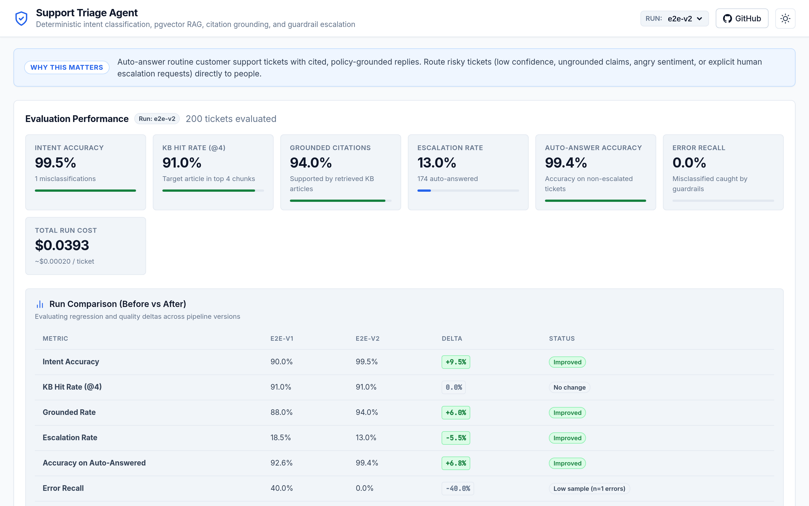
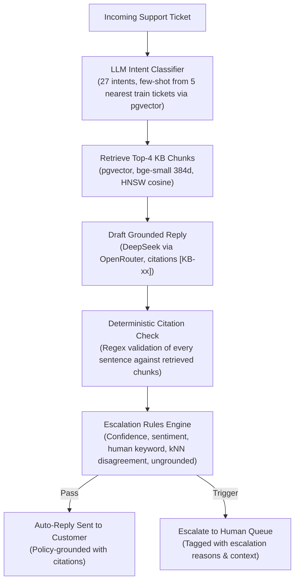

# Support Triage Agent

Customer support triage pipeline combining 27-intent LLM classification, pgvector retrieval-augmented generation (RAG), strict regex citation validation, and deterministic safety escalation guardrails. Built for SaaS and e-commerce support engineering workflows where customer-facing replies must remain policy-grounded, verifiable, and cheap to run.

Live demo: https://jorge-ai700.github.io/support-triage-agent/



---

## The Business Problem

A large share of tier-1 work in SaaS and e-commerce support is routine, repetitive tickets: checking delivery windows, explaining cancellation terms, sending invoice copies, or walking users through password resets. These inquiries rarely require human discretion, but when handled manually, they introduce high labor costs, inconsistent policy interpretations, and sluggish response times during peak demand.

Deploying generative AI directly into customer support creates a distinct operational hazard: ungrounded hallucinations, inaccurate commitments (such as unauthorized refund approvals), and tone-deaf responses to angry customers. The goal of this system is to safely automate routine tier-1 tickets by generating strictly grounded replies citing official knowledge base articles, while reliably detecting and escalating high-risk inquiries—such as ambiguous requests, policy edge cases, angry tone, and human escalation demands—to human staff, with complete metric observability across the pipeline.

---

## Where It Adds Value

1. **Deflection of Routine Tickets**: Resolves standard informational requests immediately without placing load on support queues.
2. **Policy-Grounded Accuracy with Citations**: Replaces freeform generation with constrained drafting where every sentence must cite an active knowledge base chunk (`[KB-xx]`). Uncited claims fail automated validation.
3. **Deterministic Safety Guardrails**: Escalate tickets to human agents based on low classification confidence, sentiment triggers, kNN intent disagreement, or unverified citations.
4. **Negligible Inference Cost**: Utilizes lightweight embedding models (`bge-small-en-v1.5`) and cost-efficient LLM inference (`deepseek-v4.1-flash-1017`) coupled with response caching, resulting in an operating cost under $0.0002 per ticket.

### Illustrative Impact Model

The table below outlines a theoretical cost-benefit model for a medium-volume support organization.

> Note: The operational figures below are illustrative planning assumptions, not measured customer data. True deflection and operational savings require validation in a live pilot tracking customer satisfaction (CSAT) and 7-day ticket reopen rates.

| Parameter | Value | Calculation / Source |
| :--- | :--- | :--- |
| Monthly ticket volume | 10,000 | Baseline support team ticket intake assumption |
| Fully-loaded human cost per ticket | $4.00 | Assumed blended tier-1 agent cost (salary, benefits, tooling) |
| Current monthly support labor cost | $40,000 | 10,000 tickets * $4.00 / ticket |
| Auto-answer share (v2) | 87.0% | Measured end-to-end non-escalated rate (1.00 - 0.13 escalation rate) |
| Routine tickets deflected per month | 8,700 | 10,000 tickets * 87.0% auto-answered |
| Tickets escalated to human agents | 1,300 | 10,000 tickets * 13.0% escalated |
| Measured LLM inference cost / ticket | $0.0001965 | Measured v2 benchmark ($0.0393 per 200 tickets) |
| Total monthly LLM API expense | ~$1.97 | 10,000 tickets * $0.0001965 / ticket |
| Remaining human support labor expense | $5,200 | 1,300 escalated tickets * $4.00 / ticket |
| Total monthly operating cost | ~$5.2k | $5,200 (human labor) + $1.97 (model inference) |
| **Upper-bound monthly savings** | **~$34.8k** | **$40,000 baseline - ~$5.2k new operating cost. Upper bound: assumes every auto-answered ticket is truly resolved, and ignores build, monitoring and QA costs** |

Real-world deployment deflection cannot be assumed from offline accuracy alone. Establishing true deflection requires running a controlled pilot measuring First Contact Resolution (FCR), post-interaction CSAT, and 7-day reopen rates against a control cohort.

---

## How It Works



1. **Classification**: The incoming ticket instruction is embedded and matched against training tickets in pgvector to pull the 5 nearest neighbors. The LLM classifies the inquiry across 27 intents and 11 categories using contrastive definitions and dynamic few-shot context.
2. **Knowledge Retrieval**: The ticket text is searched against the knowledge base chunk index in pgvector using HNSW cosine distance, returning the top-4 most relevant policy sections.
3. **Grounded Reply Generation**: The model synthesizes a customer reply using only the retrieved KB context, tagging every statement with explicit chunk citations (e.g., `[KB-03]`).
4. **Deterministic Citation Verification**: Python regex splits the reply into sentences and verifies that every factual clause links to a retrieved chunk present in the prompt. Any uncited sentence flags the entire reply as ungrounded.
5. **Guardrail Escalation Engine**: The ticket is routed to human queues if it triggers any escalation rule:
   - Low model confidence (< 0.70)
   - Ungrounded reply or missing citations
   - Sensitive customer sentiment (anger, abuse, legal threats)
   - Explicit human agent request
   - kNN intent disagreement (predicted intent differs from top training neighbors)

---

## Results

### End-to-End Evaluation (200-Ticket Identical Evaluation Set)

Both versions were evaluated across the same 200 held-out test tickets covering all 27 support intents.

| KPI | v1 | v2 | Delta |
| :--- | :--- | :--- | :--- |
| Intent accuracy | 90.0% | 99.5% | +9.5% |
| KB hit rate @4 | 91.0% | 91.0% | 0.0% |
| Grounded replies | 88.0% | 94.0% | +6.0% |
| Escalation rate | 18.5% | 13.0% | -5.5% |
| Accuracy on auto-answered tickets | 92.6% | 99.4% | +6.8% |
| Misclassifications caught by escalation | 40.0% (8/20) | 0.0% (0/1) | -40.0% (n=1 error) |
| LLM cost for the run | $0.0337 | $0.0393 | +$0.0056 (~$0.0002/ticket) |

### Full Test-Set Classification (5,419 Held-Out Tickets)

- **v1 Prompt**: Intent accuracy **91.05%**, Category accuracy **96.11%**, Total cost **$0.15**
- **v2 Prompt**: Intent accuracy **99.63%**, Category accuracy **99.94%**, Intent macro-F1 **0.9963**, Total cost **$0.19**

> Caveat on synthetic benchmark data: Bitext tickets are template-generated, so the nearest training tickets closely resemble test tickets; this makes kNN few-shot unusually strong, and real-world tickets would score lower.

### Confidence Calibration Analysis (v1 Baseline)

Evaluating calibration across 5,419 test tickets demonstrated that the LLM's raw probability estimates correlate strongly with ground-truth accuracy:

| Confidence Bucket | Ticket Count | Empirical Accuracy | Mean Confidence |
| :--- | :--- | :--- | :--- |
| 0.80 - 1.00 | 4,603 | 94.2% | 0.934 |
| 0.60 - 0.80 | 262 | 82.8% | 0.747 |
| 0.40 - 0.60 | 469 | 73.8% | 0.587 |
| 0.20 - 0.40 | 80 | 38.8% | 0.390 |
| 0.00 - 0.20 | 5 | 40.0% | 0.120 |

Confidence thresholds below 0.70 capture the vast majority of classification errors, validating confidence gating as an escalation trigger.

---

## What Changed in v2 and Why

Analysis of v1 failure modes on the 5,419 test set revealed persistent confusion clusters between semantically adjacent intents:
- `check_invoice` -> `get_invoice`: 91 errors (user asking to inspect invoice details vs download a copy)
- `switch_account` -> `edit_account`: 56 errors (switching profiles vs modifying profile credentials)
- `track_order` <-> `delivery_period`: 72 reciprocal errors (asking for current transit location vs general shipping duration)
- `delivery_options` -> `place_order`: 27 errors (asking about shipping carriers vs purchasing)
- `track_refund` -> `get_refund`: 23 errors (status inquiry vs requesting money back)

To resolve these boundaries, v2 introduced four architectural refinements:
1. **Contrastive Intent Definitions**: System prompt rules directly contrasting ambiguous pairs (e.g., explicitly instructing that viewing an invoice is `check_invoice` while requesting a file download is `get_invoice`).
2. **kNN Dynamic Few-Shot Examples**: For each ticket, pgvector queries the 5 closest training tickets in vector space and injects them as concrete classification demonstrations.
3. **kNN Disagreement Escalation Rule**: If the LLM's predicted intent conflicts with the majority intent among the 5 nearest neighbors, the ticket is flagged for human review.
4. **Stricter Citation Prompting**: Prompt constraints requiring every claim to cite specific knowledge base IDs, paired with improved sentence splitting to prevent formatting artifacts from triggering false grounding rejections.

---

## Challenges and What I Learned

- **Data Leakage in Open Datasets**: The Bitext dataset contains duplicate customer instruction phrasings with varying metadata. A standard random row-level train/test split placed 457 identical instruction texts into both sets. The split was rewritten to partition on unique instruction text (stratified by intent with seed 42), producing a strict 21,453 train / 5,419 test partition with zero text overlap.
- **Citation Checker Parsing Bug**: In initial v2 evaluation runs, measured grounding unexpectedly collapsed from 83% to 56.5%. Manual inspection revealed that the drafted replies were fully cited, but inline numbered lists (`...[KB-02]. 2. Next step`) left the number prefix (`"2."`) parsed as an isolated, uncited sentence fragment. Fixing the sentence segmentation regex restored grounded rates to 94.0%. A regression test was added to prevent recurrence, and runs were re-scored from the response cache at $0.00 cost. Lesson: inspect failure samples directly before questioning model quality.
- **Hidden Reasoning Tokens**: DeepSeek-v4.1 models consume internal reasoning tokens by default. When paired with restrictive `max_tokens` limits for classification tasks, the model exhausted its token budget on hidden chain-of-thought, returning truncated or empty outputs. Explicitly disabling reasoning for classification endpoints stabilized latency and guaranteed deterministic JSON output.
- **Small-Sample Metric Distortion**: In the 200-ticket v2 evaluation, the pipeline produced only 1 classification error. Because that single error bypassed guardrails, "Error Recall" registered as 0% (0/1), which could naively be read as a regression despite intent accuracy climbing from 90.0% to 99.5%. Evaluating safety recall on rare events requires high-volume test sets.

---

## Architecture and Technical Choices

- **FastAPI + Python**: Lightweight, type-safe API runtime for serving inference and triage endpoints.
- **Postgres 16 + pgvector (Docker)**: Unified database store holding ticket text, relational metadata, analytical logs, and high-dimensional vector embeddings. Avoids dual-database synchronization overhead while enabling combined SQL filtering and HNSW cosine similarity search.
- **BAAI/bge-small-en-v1.5**: Compact 384-dimensional embedding model with strong semantic retrieval performance and zero license fees. Training embeddings were precomputed using a free Google Colab T4 GPU instance and loaded via Parquet, removing local GPU requirements.
- **OpenRouter + DeepSeek (`deepseek/deepseek-v4.1-flash-1017`)**: Fast, cost-efficient inference via OpenAI-compatible API schemas, keeping overall evaluation costs under $0.20 per full test run while enabling rapid model swapping.
- **Relational Response Cache Table**: Stores LLM prompt hashes and responses in Postgres, ensuring reproducible evaluation runs and eliminating API costs during prompt parsing or reporting iterations.
- **Codex CLI & Antigravity CLI**: Used as local coding agents under my architectural direction to accelerate test writing, migrations, and evaluation harness development.
- **GitHub Pages Static Console**: Static dashboard consuming pre-exported evaluation JSON, allowing hiring managers to explore ticket traces without running local servers or exposing API keys.

---

## Data and License

- **Dataset**: [Bitext Customer Support LLM Chatbot Training Dataset](https://huggingface.co/datasets/bitext/Bitext-customer-support-llm-chatbot-training-dataset) (26,872 samples across 27 intents and 11 categories).
- **Dataset License**: Community Data License Agreement – Sharing, Version 1.0 (CDLA-Sharing-1.0), copyright (c) Bitext Innovations. Raw files are ingested at runtime and excluded from source control.
- **Knowledge Base**: 27 custom markdown policy documents located in `kb/`, authored specifically for this project to represent typical e-commerce operations for the fictional company "Acme Store".

---

## Run It Locally

### Prerequisites

- Docker and Docker Compose
- Python 3.11+
- OpenRouter API key (configured in `.env`)

### Setup and Execution

1. Clone repository and configure environment variables:
   ```sh
   cp .env.example .env
   # Add your OPENROUTER_API_KEY to .env
   ```

2. Start the Postgres + pgvector database:
   ```sh
   docker compose up -d
   ```

3. Ingest raw dataset and apply schema migrations:
   ```sh
   make ingest
   ```

4. Precompute and load ticket embeddings:
   - Run `notebooks/embed_tickets_colab.ipynb` in Google Colab (free T4 GPU) to generate `data/embeddings.parquet`.
   - Place `embeddings.parquet` in `data/` and load into Postgres:
     ```sh
     make load-embeddings
     ```

5. Execute end-to-end evaluation runs:
   ```sh
   # Run v1 baseline evaluation (200 tickets)
   make e2e-v1

   # Run v2 improved pipeline evaluation (200 tickets)
   make e2e-v2
   ```

6. Generate comparative evaluation report:
   ```sh
   make e2e-compare RUN_A=e2e-v1 RUN_B=e2e-v2
   ```

7. Export evaluation data for the static demo console:
   ```sh
   python3 scripts/export_demo.py --runs e2e-v1 e2e-v2
   ```

8. Start the FastAPI triage server:
   ```sh
   make api
   ```

9. Run unit and integration tests:
   ```sh
   make test
   ```

---

## Repository Map

```
├── app/
│   └── main.py                   FastAPI service exposing /triage endpoint for real-time ticket inference
├── data/                         Local data directory for raw dataset and embeddings (git-ignored)
├── docs/                         Static GitHub Pages evaluation and trace exploration console
│   ├── app.js                    Interactive dashboard logic, filtering, and ticket trace rendering
│   ├── index.html                Single-page application layout and KPI comparison table
│   ├── styles.css                CSS styling supporting light and dark themes
│   └── data/demo.json            Pre-exported evaluation runs and ticket traces for the static demo
├── evals/                        Evaluation harnesses, metrics generation, and regression tests
│   ├── classification_report.py  Confusion matrices, F1 scores, and calibration reporting
│   ├── e2e_report.py             End-to-end KPI aggregation and delta comparison reporter
│   ├── results/                  JSON metrics and markdown evaluation reports
│   └── test_*.py                 Test suites covering splits, citation parsing, RAG, and guardrails
├── kb/                           27 Acme Store markdown policy articles mapped to support intents
├── notebooks/
│   └── embed_tickets_colab.ipynb Colab notebook for batch ticket embedding on a free T4 GPU
├── pipeline/                     Production agent logic and processing components
│   ├── citations.py              Deterministic sentence splitting and chunk citation validator
│   ├── classify.py               LLM intent classifier supporting zero-shot and kNN few-shot
│   ├── escalate.py               Deterministic escalation policy engine and sentiment guards
│   ├── ingest.py                 Bitext ingest script with leak-free text-level train/test split
│   ├── llm.py                    OpenRouter client with response caching and token cost tracking
│   ├── rag.py                    Knowledge base context injection and grounded reply drafter
│   ├── retrieve.py               HNSW vector search over knowledge base and training embeddings
│   └── run_e2e.py                End-to-end pipeline runner for batch evaluation runs
├── scripts/                      Data loading, embedding, and static demo export utilities
│   ├── build_kb.py               Knowledge base article generator from intent definitions
│   ├── embed_kb.py               Embeds knowledge base articles into pgvector
│   ├── export_demo.py            Exports evaluation runs into docs/data/demo.json
│   ├── load_embeddings.py        Bulk loads parquet embeddings into pgvector
│   └── load_kb.py                Populates knowledge base tables and chunk indices
├── sql/                          Database schema definitions and migration scripts
│   ├── migrations/               Incremental SQL migrations (embeddings, cache, v2 rules)
│   ├── schema.sql                Primary schema for tickets, KB chunks, and classification logs
│   └── filters.sql               Analytical queries for triage monitoring and escalation audit
├── docker-compose.yml            Postgres 16 container definition with pgvector extension
├── Makefile                      CLI task runner for ingestion, evaluation, testing, and serving
├── pyproject.toml                Project package configuration
└── requirements.txt              Pinned Python dependencies
```

---

## Limitations and Next Steps

- **Synthetic Dataset**: The Bitext dataset is generated from templates. While useful for controlled benchmarking, ticket phrasing exhibits less grammatical noise, spelling variance, and conversational ambiguity than actual production queues.
- **Fictional Knowledge Base**: The 27 Acme Store articles were authored specifically for this project. They reflect standard policies but do not capture complex cross-article dependencies present in mature enterprise support documentation.
- **Evaluation Sample Size**: The primary end-to-end evaluation operates on a 200-ticket slice. While sufficient for macro KPI shifts, low-frequency events (such as safety recall on misclassifications) require larger evaluation batches (e.g., 1,000+ tickets).
- **Absence of Human-Scored Quality Ratings**: Groundedness is currently verified deterministically via citation presence, but linguistic fluency, conciseness, and customer helpfulness are not yet scored by human reviewers.

### Next Steps

- **Golden Set Evaluation with Promptfoo**: Implement automated continuous integration testing against a curated set of 100 adversarial customer tickets using Promptfoo.
- **LLM-as-a-Judge Validation**: Add G-Eval or MT-Bench style evaluation prompts to score reply clarity and empathy, calibrated against a sample of human agent ratings.
- **Public Interactive API**: Package the FastAPI service and Postgres database into a Hugging Face Spaces free-tier container for live interactive testing.
- **Multilingual Ticket Triage**: Expand embeddings and classification prompts to handle Spanish, French, and German customer inquiries natively.

---

## Author

Jorge Luis Hernandez Vera  
IE Business School (Master in Management - MIM)
